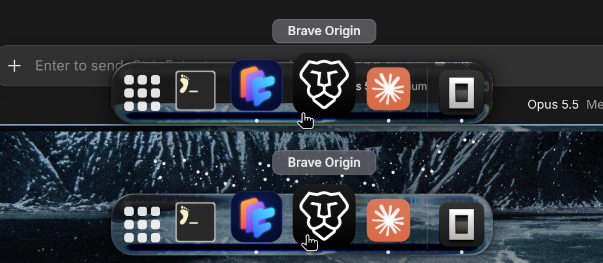

# EchoDock

A macOS-style dock for [Omarchy](https://omarchy.org) and Hyprland, with real Liquid Glass.



EchoDock is drawn on the GPU with **rune-dock**, a fork of the [Rune](https://github.com/anomalyco/rune) UI framework that lives in this repository. Its glass is a lens, not a blur. It refracts a **live** picture of what's behind the dock: the wallpaper plus every window on the current workspace, each captured on its own through Hyprland's toplevel export. Because the dock never captures itself, the glass can follow workspace switches, moving windows and video while it's open, and it costs nothing while hidden.

## Features

- **Every workspace, every monitor.** Hidden until the pointer reaches the bottom edge (or always shown, or hidden only when a window is in the way).
- **Dock items.** Magnification wave, app names, running-app dots, a launch bounce, and pinned and running apps with a separator. The apps button opens your launcher, and an optional Trash item opens the trash.
- **Click behaviour.** Click to open or focus, click again to cycle that app's windows, middle-click for a new window. An optional setting makes clicking the focused app's only window minimize it, as on Windows.
- **Right-click menu.** The app's windows, its desktop actions (jump list), New Window, Minimize All, Keep in Dock / Remove from Dock, and Quit.
- **Liquid Glass.** Lens refraction, colour split at the rim, specular light that reflects the surroundings, adjustable frost and tint, and a live backdrop at a rate you choose.
- **EchoDock Settings.** Every option in one window. Changes apply live.
- **Shortcuts and `echodock ctl`.** Control the dock from the keyboard and scripts.

| Keys | Does |
|---|---|
| Ctrl+Alt+1…9 | Open or focus the app in that dock slot |
| Ctrl+Alt+Shift+1…9 | New window of that app |
| Super+Alt+T | Show or hide the dock |
| Super+Alt+D | Toggle auto-hide |
| Super+M | Minimize the window to the dock |
| Super+Alt+Space | Open the app launcher |

```sh
echodock ctl list          # the dock's apps, numbered
echodock ctl activate 3    # open or focus app 3
echodock ctl reveal        # show the dock
echodock ctl autohide off  # keep it on screen
```

## Install

Needs Rust (stable), Hyprland 0.57+, `grim` (fallback captures) and `jq`.

```sh
./install.sh
```

This builds EchoDock and installs `echodock` and `echodock-settings` into `~/.local/bin`. It also adds `~/.config/hypr/echodock.lua` (autostart, shortcuts) to your Hyprland config and turns off Omarchy's own dock. Every file it changes is backed up first. Settings live in `~/.config/echodock/config.toml`.

## Layout

| Path | What |
|---|---|
| `crates/echodock` | The dock: overlays, worker thread, glass compositor, live backdrop |
| `crates/echodock-core` | Config, Hyprland IPC, desktop entries and icons, the ctl socket |
| `crates/echodock-settings` | EchoDock Settings |
| `rune-dock` | EchoDock's Rune: per-output layer-shell surfaces on the chosen layer, and Liquid Glass lighting |
| `assets` | Hyprland module and launcher entry |

## License

MIT. rune-dock is based on Rune (MIT, © Anomaly); see `rune-dock/LICENSE`.
